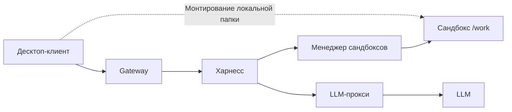

# eval-stand-for-agents: среда исполнения агента

## Что это

Клиент-серверная среда для сравнительной оценки сочетаний харнессов и языковых моделей. Агент работает с локальной папкой пользователя, смонтированной в удалённый сандбокс; результаты сравниваются по качеству, времени выполнения и расходу токенов. Конкретные харнессы, сандбокс и механизм монтирования ещё не выбраны.

## Архитектура



[Дизайн-документ и схема решения](docs/ml_system_design_doc.md). [Архитектурные решения](docs/adr/README.md).

## Запуск сервера

Команды для сборки и очистки сервера. Исходники сервисов и Dockerfile ещё предстоит добавить.

```bash
cp .env.example .env        # заполнить
docker compose up --build   # поднимает весь сервер
docker compose down -v      # полная очистка
```

## Клиент

Стек клиента ещё не выбран. Интерфейс подключения и headless-команды описаны в [client/README.md](client/README.md); инструкции сборки и запуска будут добавлены вместе с реализацией.

## Тесты

Для инструментов проверки нужны Python 3.11 или новее и Git. Подготовка окружения из корня репозитория:

```bash
python3 -m venv .venv
source .venv/bin/activate
python -m pip install -r requirements-dev.txt
pre-commit install
```

Проверка и форматирование Python:

```bash
make check       # Ruff: линтер и проверка форматирования
make format      # исправления Ruff и форматирование
make pre-commit  # все хуки для отслеживаемых Git файлов
```

Настройки Ruff находятся в [pyproject.toml](pyproject.toml), версии инструментов — в [requirements-dev.txt](requirements-dev.txt), хуки — в [.pre-commit-config.yaml](.pre-commit-config.yaml). Pre-commit запускает Ruff и проверяет YAML, TOML, маркеры конфликтов и пробельные символы при коммите. Первый запуск требует сети для установки окружений хуков. Если хук исправил файл, проверьте изменения, повторно выполните `git add` и коммит.

Цели среды исполнения из таблицы пока содержат заглушки и не выполняют проверки.

| Команда | Что запускает |
|---|---|
| `make test-ci` | UI + инфраструктурные + smoke-БАФ (CI, без внешней сети) |
| `make test-ui` | UI-микросценарии клиента |
| `make test-infra` | инфраструктурные тесты |
| `make baf PAIR=<harness>+<model>` | полный БАФ-бенчмарк для пары |
| `make bench-fs` | замеры ФС через монтирование (A-3.6) |
| `make bench-sandbox` | замеры сандбокса (A-5.6) |

## Структура

```
services/          gateway, harness, sandbox-manager, llm-proxy — исходники и Dockerfile
client/            десктоп-клиент (+ headless/CLI режим для тестов)
contracts/         схемы протоколов клиент↔сервер и харнес↔сандбокс
baf/               задачи БАФ: основные + дополнительные
tests/ui/          UI-тесты
tests/infra/       инфраструктурные тесты
docs/adr/          архитектурные решения
docs/harness.md    как устроен харнес
docs/baf.md        свои БАФ и обоснование
docs/report.md     отчёт: замеры, матрица БАФ × пара, выводы
results/           сырые результаты прогонов
```

## Модели

Модели ещё не выбраны. Для каждой выбранной модели будут зафиксированы версия, значение Intelligence Index по Artificial Analysis и дата проверки.
