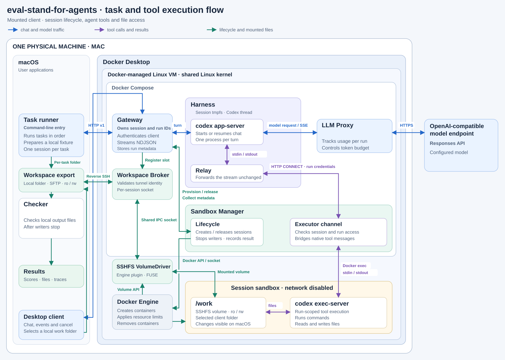

# eval-stand-for-agents: среда исполнения агента

## Что это

Стенд для оценки пар «харнес + LLM» по базисным агентским функциям.
Раннер создаёт локальную копию фикстуры каждой задачи, монтирует её в
`/work` через SSHFS и запускает Codex в отдельном Docker-сандбоксе.

## Архитектура



[Харнес](docs/harness.md), [контракты](contracts/README.md), [ADR](docs/adr/README.md).

## Запуск сервера

Нужны Docker Engine с одной vCPU, Compose, Buildx и FUSE в ядре Linux.
Для Docker Desktop выделите 32 ГБ диска. Перед сборкой остановите стек
и проверьте свободное место в Docker и на хосте.

```bash
cp .env.example .env
```

Заполните токены в `.env` и выставьте `DOCKER_PLATFORM` под архитектуру
Docker Engine. Один раз создайте BuildKit с квотой 1 vCPU, 7 ГБ RAM и
одним одновременно исполняемым шагом.

```bash
docker buildx create --name eval-stand-compose --driver docker-container \
  --driver-opt 'image=moby/buildkit:v0.34.2@sha256:c5f8862f52499773af85bc07695b2379ef08e8002352b0df2c4864c91d78dabe' \
  --driver-opt memory=7000000000 --driver-opt memory-swap=7000000000 \
  --driver-opt cpu-quota=100000 --driver-opt cpu-period=100000 \
  --driver-opt restart-policy=no --buildkitd-config docker/buildkit.toml
export BUILDX_BUILDER=eval-stand-compose
export DOCKER_DEFAULT_PLATFORM=linux/arm64 # на x86_64 используйте linux/amd64
```

Для профиля `api` заполните `MODEL_ID`, `MODEL_ENDPOINT` и `MODEL_API_KEY`
и укажите `COMPOSE_FILE=docker-compose.yml:docker/compose.live.yml` в `.env`.
Используйте базовый HTTPS URL Responses-совместимого API без `/responses`.
Для локального mock-прогона укажите
`COMPOSE_FILE=docker-compose.yml:docker/compose.mock.yml`.

```bash
docker compose up --build
docker compose down -v
```

Compose собирает Codex из закреплённого коммита. Sandbox Manager сверяет
образ, публикует provenance для Gateway и регистрирует SSHFS-драйвер с
`CAP_SYS_ADMIN` и `/dev/fuse`. `down -v` удаляет серверное состояние, включая
историю. Для остановки с сохранением истории используйте `docker compose down`.

## Клиент

Запустите окно macOS командой `.venv/bin/python -m client.gui`. Введите
адрес Gateway и токен, выберите папку и режим доступа. Рабочая папка
откроется в сандбоксе как `/work`. [Подготовка клиента и headless CLI](client/README.md)

## Тесты

| Команда | Что запускает |
|---|---|
| `make test-ui` | [UI-микросценарии клиента](tests/ui/README.md) с mock Gateway |
| `make test-infra` | Инфраструктурные тесты с mock LLM |
| `make baf DATASET=baf/control.yaml PROFILE=api` | Прогон [контрольного датасета](baf/control.yaml) на настроенном профиле |
| `make baf-smoke` | [Smoke Б1–Б8](baf/README.md#режимы-прогона) на mock |

Раннер выполняет по одной попытке на задачу из переданного датасета.
[Формат датасета и отчёта](baf/README.md).
[Подготовка инфраструктурных тестов](tests/infra/README.md) и
[воспроизведение отмены и продолжения чата](docs/adr/0006-mounted-client-runtime.md#воспроизведение).

Для компонентных тестов используйте `.venv/bin/python -m pytest -q`, для
проверки стиля - `make check`, для проверки всех файлов хуками -
`make pre-commit`. Установка хуков - `.venv/bin/pre-commit install`.

[Анализ задач и воспроизведение сохранённых измерений](docs/eda.md#воспроизведение).

## Структура

```text
services/                      gateway, harness, sandbox_manager, llm_proxy
client/                        десктоп-клиент и headless CLI
contracts/                     схемы протоколов
baf/                           задачи БАФ и раннер
tests/ui/                      описание UI-микросценариев
tests/infra/                   инфраструктурные тесты
docker/                        Dockerfile и конфигурации Compose
scripts/                       подготовка и запуск
docs/adr/                      архитектурные решения
docs/harness.md                устройство харнесса
docs/baf.md                    свои БАФ и правила оценки
docs/report.md                 замеры, матрица БАФ × пара, выводы
docs/ml_system_design_doc.md    дизайн-документ
docs/eda.md                     анализ оценочных данных
results/                       результаты прогонов
```

## Модели

Текущий профиль `api` получает модель и endpoint из `MODEL_ID` и
`MODEL_ENDPOINT`; API-ключ `MODEL_API_KEY` доступен только LLM-прокси.
Для совместимого Responses endpoint достаточно настроить профиль; другой
формат API подключается отдельным адаптером. [Настройка](#запуск-сервера).
