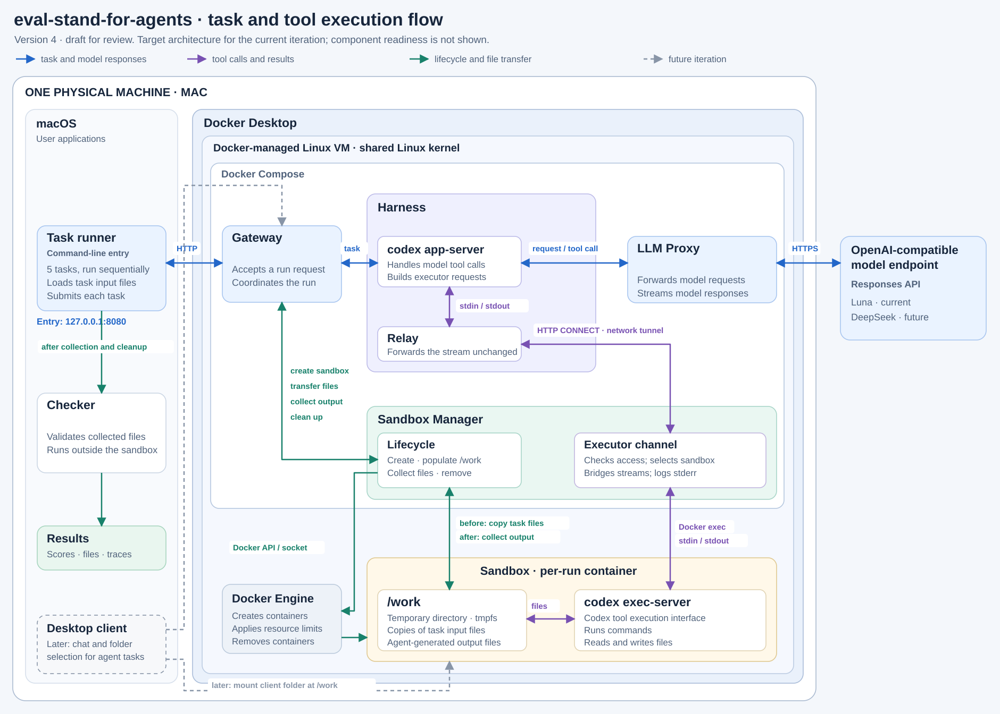

# eval-stand-for-agents: среда исполнения агента

## Что это

Стенд для оценки сочетаний харнессов и языковых моделей по базовым агентским функциям. Первая итерация использует Codex, отдельный Docker-сандбокс на задачу и последовательный Python-раннер B1.1–B5.1. Качество файлов проверяется доверенными чекерами вне рабочей среды агента.

Начать знакомство: [структура репозитория](#структура), [итоговый отчёт](docs/report.md), [указатель результатов](results/README.md).

## Архитектура



[Дизайн-документ](docs/ml_system_design_doc.md), [контракты v0](contracts/README.md), [устройство харнесса](docs/harness.md), [архитектурные решения](docs/adr/README.md).

## Запуск сервера

Нужны Git, uv 0.12.1 и Docker с Compose/Buildx. Команды ниже используют Docker engine с одной vCPU; `preflight --shared-cpu` проверяет это условие, не меняя настройки машины. Общий потолок RAM — 8 000 000 000 байт. Для текущего Docker Desktop пользователь выделил 32 ГБ диска; фактически свободное место измеряется отдельно. Сборка и прогоны выполняются по очереди.

Подготовка из корня проекта при остановленном стеке:

```bash
uv sync --frozen
.venv/bin/python -m scripts.build_codex
```

Контроллер собирает Codex 0.159.3 из закреплённого commit, ограничивает builder одной vCPU, 7 ГБ RAM и 60 минутами. Успешная сборка сохраняет `provenance.runtime.json` в выведенном каталоге `results/source-build-*` и выгружает бинарник в `build/codex-artifact`. Подставьте путь своего успешного запуска:

```bash
PROVENANCE='results/source-build-<timestamp>/provenance.runtime.json'
.venv/bin/python -m scripts.configure_local --provenance "$PROVENANCE"
```

`configure_local` проверяет локальный образ, создаёт `.env` с отдельными управляющими токенами, UID/GID и путями, сохраняет существующие токены и не выводит их значения. `.env`, `.auth/` и выгруженный бинарник исключены из Git; `.auth/` также исключён из Docker build context. Авторизацию модели в `.env` записывать не нужно.

Для офлайн-контура соберите сервисы и оба фиктивных провайдера. Здесь показан ARM64; на x86_64 Linux используйте `linux/amd64` и source-build той же архитектуры:

```bash
.venv/bin/python -m scripts.preflight --shared-cpu
DOCKER_DEFAULT_PLATFORM=linux/arm64 COMPOSE_PARALLEL_LIMIT=1 docker compose -f docker-compose.yml -f docker/compose.mock.yml -f docker/compose.single-cpu.yml --profile tools build --builder eval-stand-codex-source
docker buildx stop eval-stand-codex-source
make test-offline
```

`test-offline` запускает существующий [offline-suite](tests/infra/offline_suite.py): Python-проверки, реальные Codex/exec-server, сбои и восстановление, сбор файлов и обе формы остановки. Он требует остановленный стек и готовые образы, не собирает и не скачивает их, не обращается к Luna. Mock override отключает внешний маршрут. Итог — новый `results/offline-suite-*/summary.json`; отдельные артефакты перечислены в нём. Проверки остановки удаляют серверные тома своего проекта, сохраняя выгруженные результаты и `.auth/`.

Для live-контура сначала выполните ручной вход в отдельное хранилище проекта при остановленном harness:

```bash
.venv/bin/python -m scripts.auth_setup --provenance "$PROVENANCE"
```

Команда использует нативный device-login source-built Codex и сохраняет только выделенную авторизацию в `.auth/`; личный `~/.codex` не читается и не копируется. Существующий `current.json` не заменяется. Если после прерывания нативный `auth.json` уже сохранён, тот же вызов с `--resume` завершает импорт без нового входа. Если файл не появился, новый вход требует явного `--retry-login`. Автоматического повтора login нет.

Live Compose добавляет `.auth/` как read-write mount только в harness и read-only mount в llm-proxy. После настройки авторизации:

```bash
make up
make checkpoint1 PROFILE=luna
```

Обе команды используют `docker-compose.yml`, `docker/compose.live.yml` и `docker/compose.single-cpu.yml` после проверки общего одного CPU. `make up` отказывается собирать образы поверх запущенного стека, выполняет сборку последовательно, останавливает builder и ждёт healthcheck. Gateway доступен только на `127.0.0.1:${GATEWAY_PORT:-8080}`. Совпадение UID/GID сервисов и владельца `.auth/` задаётся через `.env` при подготовке.

Раннер запускается одноразовым контейнером, выполняет ровно B1.1–B5.1 по одному разу и сохраняет новый `results/<batch-id>/report.json`. Для Luna цель — 30 000 фактических входных и выходных токенов: следующий запрос блокируется после достижения цели, последний может превысить её. Отдельный `max_output_tokens=2048` ограничивает каждый ответ. Неизвестный usage блокирует продолжение; отчёт сохраняет `mode`, `actual`, `output_limit`, `over_target` и причину отсутствия usage. Модель и способ оплаты автоматически не меняются.

`make down` сначала подтверждает очистку динамических сред, затем удаляет серверные тома. Это явная граница истории run id и гарантии повторного запроса; `results/` и `.auth/` сохраняются. Для остановки без удаления истории используйте `docker compose -f docker-compose.yml -f docker/compose.live.yml -f docker/compose.single-cpu.yml down`. Source-build, полный offline-набор с атаками на сборщик, live-прогоны и итоговое ревью подтверждены в [отчёте](docs/report.md).

## Клиент

Десктоп-клиент, пользовательские сессии и монтирование папки клиента отложены в текущей итерации. Раннер не закрывает требование курса о подключении клиента. [Будущий интерфейс](client/README.md).

## Тесты

Python 3.13.2 закреплён в `.python-version`; код рассчитан на Python 3.11–3.13. Полное окружение, включая транзитивные зависимости и хеши, закреплено в `uv.lock`. Проверенная версия менеджера окружения — uv 0.12.1.

```bash
uv sync --frozen
.venv/bin/pre-commit install
make check
make test-checkpoint1
make pre-commit
```

После установки зависимостей `make test-checkpoint1` не требует внешней сети или авторизации модели. В набор входят схемы, чекеры, раннер, жизненный цикл на тестовых зависимостях и локальные HTTP/CONNECT-проверки. Они требуют разрешения ОС на loopback-сокеты. Это не доказательство реального маршрута Codex/Docker и не оценка качества Luna.

| Команда | Что запускает |
|---|---|
| `make check` | Ruff: линтер и проверка форматирования |
| `make format` | Исправления Ruff и форматирование |
| `make pre-commit` | Настроенные хуки для отслеживаемых файлов |
| `make test-checkpoint1` | Текущий офлайн-набор Python-проверок |
| `make test-offline` | Единый Python + native Docker-набор на заранее собранных образах; начинает с остановленного стека |
| `make checkpoint1 PROFILE=luna` | Пять live-задач против готового gateway, с проверкой общего CPU |
| `make up` | Сборка и запуск live Compose с выделенной `.auth/` |
| `make down` | Проверенная очистка собственных сред и удаление серверной истории |
| `make preflight-shared` | Проверка source-build образа и одного CPU Docker engine |
| `make test-ci` | Полный состав CI; пока завершается ошибкой из-за отсутствия клиента |
| `make test-ui` | Явный отказ: клиент ещё не реализован |
| `make test-infra` | Текущие компонентные инфраструктурные проверки |
| `make baf PAIR=<harness>+<model>` | Будущий полный БАФ; пока явный отказ, не сокращённый набор |
| `make bench-fs` | Замеры монтирования пока не реализованы |
| `make bench-sandbox` | Реальные замеры сандбокса пока не выполнены |

Первый запуск pre-commit требует сети для подготовки окружений хуков. Настройки: [pyproject.toml](pyproject.toml), [.pre-commit-config.yaml](.pre-commit-config.yaml).

## Структура

| Путь | Назначение |
|---|---|
| `services/` | Код четырёх сервисов; `common/` содержит общие HTTP, процессные и файловые функции |
| `baf/` | Пять задач, их входные файлы и чекеры; `runner/` последовательно запускает задачи |
| `contracts/` | JSON Schema и проверки межсервисных сообщений |
| `config/profiles.json` | Именованные профили Luna, mock и будущего DeepSeek |
| `docker-compose.yml` | Основной состав сервера; сервисы собираются через `docker/Dockerfile.services` |
| `docker/` | Дополнения Compose: `live` — авторизация, `mock` — фиктивная модель, `single-cpu` — ресурсы; здесь же сборка Codex и конфигурация BuildKit |
| `scripts/` | Подготовка окружения, сборка Codex, вход в модель, preflight, healthcheck и остановка |
| `tests/test_*.py` | Компонентные и локальные HTTP-тесты Python-кода |
| `tests/infra/` | Реальные Docker-проверки и их mock-сценарии; запускаются через `make test-offline` |
| `docs/` | Дизайн-документ, устройство харнесса, правила БАФ, отчёт и архитектурные решения в `adr/` |
| `results/` | Сохранённые отчёты и сырые доказательства; [указатель](results/README.md) объясняет имена каталогов |
| `client/`, `tests/ui/` | Описание отложенного клиента и его будущих тестов |
| `pyproject.toml`, `uv.lock` | Зависимости, настройки Python-инструментов и точные версии пакетов; установка — `uv sync --frozen` |
| `Makefile` | Короткие команды запуска и проверки |

Внутри `services/` используются Python-имена с подчёркиванием:
`gateway` принимает запросы, `harness` управляет Codex,
`sandbox_manager` создаёт и собирает сандбоксы, `llm_proxy` обращается к модели.
Имена Compose/DNS `sandbox-manager` и `llm-proxy` содержат дефисы.
Файлы `__init__.py` обозначают Python-пакеты и нужны для импорта модулей.

Локальные данные отделены от исходников:

| Путь | Что хранится |
|---|---|
| `.env` | Управляющие токены и пути текущей машины; образец — `.env.example` |
| `.auth/` | Приватная ChatGPT-авторизация; исключена из Git и образов |
| `build/codex-artifact/` | Выгруженный бинарник source-build; создаётся автоматически, не редактируется и не входит в Git |
| `.venv/`, `__pycache__/`, `.pytest_cache/`, `.ruff_cache/` | Окружение Python и автоматически создаваемые кэши |
| `openspec/`, `.agents/`, `AGENTS.md` | Локальные планы и инструкции разработки; текущий `.gitignore` исключает их из Git |

## Модели

Целевой live-профиль — `gpt-6-luna` через выделенную ChatGPT-авторизацию. Её версия, значение Artificial Analysis Intelligence Index и курсовой допуск не подтверждены; технический результат не означает допуск по требованиям курса. Профили `mock` и `mock-alt` используют искусственный счётчик токенов для проверки протокола. `deepseek` — незаполненный неактивный шаблон; рабочий endpoint не заявлен.

Общий `sandbox_model` в адаптере создаёт каталог инструментов каждой попытки: исходный model id, прямые unified_exec/freeform apply_patch и короткая инструкция стенда, без Node runtime. Подтверждены [нативный refresh](results/live-check-20261106T211035Z-24118a/auth.json), [короткая проверка инструментов](results/live-check-20261106T211931Z-0a10fa/summary.json) и один [полный live-набор Luna: 5/5 за 51,23 с](results/d72a5329d7aa4117bb41aa7995be74c9/report.json). Отрицательные ранние пробы сохранены в [отчёте](docs/report.md); курсовой допуск модели остаётся неподтверждённым.
