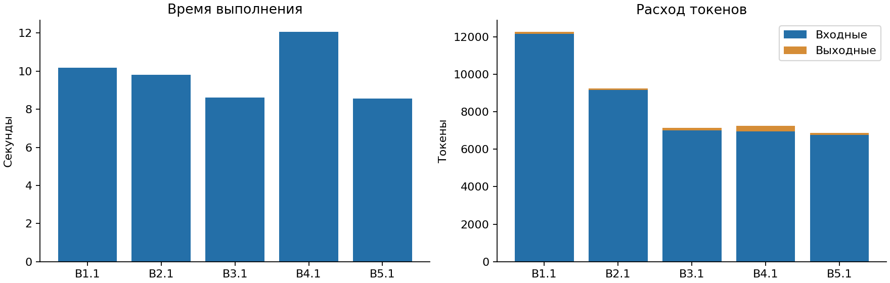

# Анализ задач и результатов

Набор оценивает, как агент работает с файлами, инструментами и несколькими
источниками информации. В [каталоге](../baf/catalog.yaml) описаны 24 задачи
на восемь базисных функций и три составные задачи. Описания задают ожидаемые
действия и критерии успеха.

## Базисные функции и сложность

| Функция | Простая задача | Средняя задача | Задача с подвохом | Что проверяет задача |
|---|---|---|---|---|
| B1. Чтение и извлечение | Найти порт в YAML | Найти срок оплаты в длинном договоре | Сообщить, что неустойка в договоре не указана | Извлечение факта и отказ от выдуманного ответа |
| B2. Поиск | Найти определение функции | Найти все обращения к переменной в дереве файлов | Выбрать нужную из одноимённых функций по поведению | Точность, полнота поиска и различение совпадающих имён |
| B3. Создание файла | Создать JSON по схеме | Перенести таблицу в CSV с сортировкой | Сохранить строковые типы YAML и ведущие нули | Корректность содержимого, структуры и типов данных |
| B4. Редактирование | Изменить версию в одном разделе | Переименовать функцию во всём проекте | Изменить цену с сохранением cp1251 и CRLF | Полноту нужной правки и сохранность остального содержимого |
| B5. Использование инструмента | Выполнить скрипт и записать медиану | Запустить тесты и собрать имена упавших | Распознать ошибку по exit code при сообщении `OK` | Выполнение команды и правильную интерпретацию её результата |
| B6. Генерация кода | Написать `slugify` по спецификации | Написать парсер логов с агрегированием | Обработать пустой ввод и календарные границы | Поведение программы на обычных и краевых случаях |
| B7. Рассуждение | Проверить возможность пересадки | Вычислить доступ с наследованием ролей и запретами | Выявить противоречие в правилах | Применение условий и обнаружение несовместимых предпосылок |
| B8. Синтез источников | Сложить продажи из нескольких CSV | Собрать решения из протоколов встреч | Выбрать актуальную версию регламента и указать расхождение | Объединение данных, полноту результата и выбор источника |

Простые задачи проверяют отдельное действие на небольшом примере. В средних
растёт объём поиска, число связей или преобразований. Варианты с подвохом
проверяют другой класс ошибок: агент может получить правдоподобный ответ,
пропустив отсутствие факта, неоднозначность, кодировку или код возврата.
Поэтому общий процент успеха дополняется результатами по функциям и типам
задач. Метки сложности заданы в каталоге; фактическая трудность для конкретной
пары определяется по результатам запусков.

Целевой набор содержит минимум 39 задач: к этим 27 добавляются по одному
варианту каждой B1–B8, три задачи новой функции и одна составная задача.
Дополнительные варианты проверят зависимость результата от конкретной
формулировки и исходных файлов. Новая функция и её задачи ещё не определены,
поэтому их содержание в анализ не включено.

## Составные задачи

| Задача | Цепочка функций | Проверяемый результат |
|---|---|---|
| C1. Исправить баг по описанию | B2 → B1 → B7 → B4 → B5 | Изменённый код проходит скрытые тесты |
| C2. Подготовить отчёт по данным отдела | B2 → B8 → B7 → B3 | Числа в отчёте совпадают с эталоном |
| C3. Добавить утилиту с тестами | B1 → B6 → B5 → B4 | Утилита проходит скрытые тесты и тесты агента |

Составная задача проверяет передачу результата между действиями. Например,
правильно найденный файл ещё нужно прочитать, связать с причиной бага и
исправить без побочных изменений. Ошибка на этой цепочке может возникнуть
даже при успехе на отдельных функциях. Разбор файлов и вызовов инструментов
позволяет установить, на каком действии нарушилось выполнение.

## Данные и критерии оценки

Входы включают конфигурации, текстовые документы, исходный код, таблицы и
правила. Оценки формируются программными чекерами: сравниваются значения и
множества, проверяются схемы, сохранность файлов и результаты тестов.
В задачах на использование инструмента нужен также факт его выполнения.
Эталон и чекер находятся вне папки агента.

Качество оценки зависит от соответствия чекера заданию. Так, B1.3 должен
принимать сообщение об отсутствии данных, B4.3 проверять кодировку вместе
с ценой, а B5.3 учитывать код возврата команды. Проверка одного итогового
числа не различает выполнение инструмента и угадывание результата.

[Исполнимый набор](../baf/checkpoint1.yaml) сейчас содержит B1.1–B5.1.
Проверены их описания, состав исходных файлов и
[реализация чекеров](../baf/runner/task_checks.py): B3.1 сверяет JSON со схемой,
B4.1 сравнивает полное содержимое файлов, B5.1 требует доказательство вызова
и неизменности входов. При замене исходных данных нужно обновлять и эталон:
например, ожидаемый порт в B1.1 задан константой. Варианты с длинными документами,
неоднозначностью, другими кодировками и составными цепочками пока представлены
описаниями, а не измерениями качества.

Имеющиеся исходные файлы содержат синтетические конфигурации, код и числа;
при просмотре персональные данные и секреты не обнаружены. Для новых документов
и таблиц проверяются происхождение и разрешение на передачу провайдеру.

## Результаты запусков

[Отчёт](../results/d72a5329d7aa4117bb41aa7995be74c9/report.json) содержит пять
попыток Codex 0.159.3 с `gpt-6-luna`, выполненных 7 ноября 2026 года в 00:20 МСК.
На каждую из B1.1–B5.1 пришлась одна попытка; все пять прошли проверку.
Длительность и токены записаны для каждой задачи.



Весь набор занял 51,23 секунды. На отдельную задачу потребовалось от 8,56
до 12,07 секунды и от 6 874 до 12 271 токена. Суммарно использовано 42 787
токенов: 42 064 входных и 723 выходных. Кэшированные 4 096 токенов уже входят
во входные. Основной расход связан с передаваемым контекстом, включая
инструкции харнесса и результаты инструментов.

B1.1 потребовала больше всего токенов, а B4.1 заняла больше всего времени.
По одному наблюдению на разные задачи нельзя установить причины различий
или оценить повторяемость. Эти измерения описывают расходы пяти простых
сценариев; качество на остальных функциях и преимущества других конфигураций
ещё не измерены. Точная версия модели в отчёте не закреплена, поэтому перенос
результатов на последующие обращения к тому же идентификатору требует проверки.

## Воспроизведение

[Скрипт анализа](../scripts/analyze_baf.py) читает каталог, исполнимый набор и
сохранённый отчёт. Он создаёт [таблицу задач и критериев](eda/task_inventory.csv),
[таблицу попыток](eda/runs.csv) и [сводку с хешами источников](eda/summary.json).
Команды запускаются из корня проекта:

```bash
.venv/bin/python -m scripts.analyze_baf
uv run --locked --with matplotlib==3.10.8 python -m scripts.analyze_baf --plots
```

Первой команды достаточно для пересчёта таблиц; вторая также строит график.
Обе используют сохранённые данные без новых обращений к модели. Полные журналы
и рабочие папки попыток не входят в опубликованные источники этого EDA;
результаты чекеров воспроизводятся здесь как записи из отчёта.
