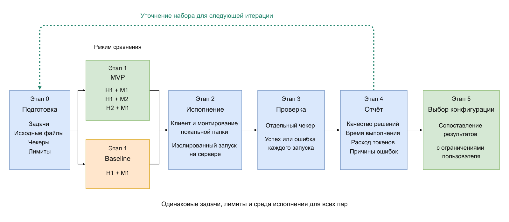

# ML System Design Doc - [RU]

## Дизайн ML системы - eval-stand-for-agents - MVP - 1

### 1. Цели и предпосылки

#### 1.1. Зачем идем в разработку продукта?

**Бизнес-цель.** Помочь разработчику агентного приложения выбрать сочетание харнесса и языковой модели для своих задач. Стенд должен проводить сравнение в одинаковых условиях и показывать, какие задачи решены, сколько времени заняло выполнение и сколько токенов израсходовано.

**Почему станет лучше от использования ML.** Языковая модель позволяет агенту выполнять задачи по текстовому описанию и выбирать инструменты. Качество зависит и от модели, и от того, как харнесс формирует контекст и обрабатывает вызовы инструментов. Стенд сравнивает готовые конфигурации на одном наборе задач и собирает результаты, которые при ручном сравнении пришлось бы сводить самостоятельно.

**Успех итерации с точки зрения бизнеса.** Разработчик может запустить сравнение, получить проверяемый отчёт и выбрать конфигурацию под свои ограничения по качеству, времени и расходу токенов. Если подходящих вариантов нет, отчёт показывает причины.

#### 1.2. Бизнес-требования и ограничения

**Бизнес-требования.** Разработчик задаёт набор задач, сравниваемые конфигурации и ограничения на выполнение. Стенд запускает задачи, проверяет результат и формирует отчёт по каждой паре «харнесс + LLM»: результаты отдельных задач и групп функций, время выполнения, расход токенов и причины ошибок. Описание компонентов и пользовательских сценариев приведено в [README](../README.md) и [требованиях к клиенту](../client/README.md).

Для работы с файлами нужен десктоп-клиент, который монтирует выбранную локальную папку в удалённый сандбокс. Правки должны быть видны в обе стороны. Пользователь выбирает режим чтения или чтения и записи, видит ход выполнения, может отменить запуск и переподключиться после обрыва связи. Клиент и сервер работают на разных машинах; для сервера допускается виртуальная машина.

**Бизнес-ограничения.** Первая версия рассчитана на одного оператора и несколько независимых сессий. Для оценки используются публичные или синтетические данные без секретов и персональных данных, разрешённые к передаче провайдеру модели. Доступность API и вычислительный бюджет ограничивают объём прогонов. Готовые программные компоненты должны иметь открытый исходный код.

**Ожидания от итерации.** Получить клиент-серверную среду и сравнить три конфигурации на одинаковых задачах.

**Бизнес-процесс пилота.** Разработчик выбирает задачи и ограничения, запускает оценку, разбирает ошибки и сопоставляет результаты с требованиями своего приложения. По итогам он выбирает конфигурацию либо уточняет требования для следующего сравнения.

**Критерии успешного пилота и дальнейшее развитие.** Для каждой конфигурации обработан весь выбранный набор задач; все запланированные запуски учтены, включая неуспешные и отменённые; проверки среды проходят; результаты доступны без ручного переноса оценок; отчёт пересчитывается из сохранённых результатов без новых обращений к LLM. Дальнейшее развитие — подключение других харнессов и наборов задач.

#### 1.3. Что входит в скоуп проекта/итерации, что не входит

**Входит в скоуп.** Клиент-серверная среда исполнения, смена харнесса и модели через конфигурацию, запуск оценочных задач и подготовка отчёта. Сервер включает gateway, харнесс, менеджер сандбоксов и LLM-прокси. Клиент предоставляет графический интерфейс и headless-режим с общим протоколом. Локальная папка монтируется в удалённый `/work`; копирование файлов не заменяет монтирование.

Среда должна ограничивать ресурсы и доступ агента, поддерживать отмену и очистку сессий. Команды должны исполняться через протокол сандбокса. Ключи провайдера должны храниться у LLM-прокси, сеть сандбокса по умолчанию закрыта. В скоуп входят проверки клиента, инфраструктуры и базисных агентских функций.

**Не входит в скоуп.** Обучение и дообучение LLM, автоматическая оптимизация промптов, создание IDE и промышленная многопользовательская эксплуатация. Стенд оценивает заранее выбранные конфигурации.

**Качество кода и воспроизводимость.** Код должен храниться в публичном репозитории с линтером, форматером, pre-commit и инструкциями в README. Сервер должен собираться из исходников командой `docker compose up --build`. Версии зависимостей, образов, моделей, харнессов и задач фиксируются; параметры прогонов и результаты сохраняются. Проверки CI должны работать без внешней сети. Повторяемость процедуры не означает идентичных ответов LLM.

**Планируемый технический долг.** Поддержка дополнительных клиентских платформ, новые адаптеры харнесса и расширенный поиск по истории экспериментов оставляются для следующих итераций.

#### 1.4. Предпосылки решения

Для сравнения используются формулировки задач, исходные файлы и программные проверки. Основной набор предусматривает 24 задачи на восемь базисных агентских функций и три составные задачи. К нему добавляются минимум восемь вариантов существующих функций, три задачи новой функции и одна составная задача — всего минимум 39 задач. Такой состав позволяет сравнивать отдельные функции агента и их последовательное выполнение.

Единица оценки - запуск одной задачи одной парой «харнесс + LLM» в новой сессии. Перед запуском восстанавливаются исходные файлы; результаты предыдущих задач в контекст не попадают. Чекеры должны проверять результат независимо от ответа агента и различать корректные и ошибочные решения. Эталонные ответы и скрытые тесты недоступны агенту.

Решение предполагает подключение харнессов к общему сандбокс-протоколу и поддержку моделями вызовов инструментов. Модели выбираются с учётом доступности API, возможности зафиксировать версию и стоимости использования. Обучающая выборка и горизонт прогнозирования не требуются: оценивается поведение готовых моделей в составе агента.

### 2. Методология `Data Scientist`

#### 2.1. Постановка задачи

Техническая задача состоит в сравнительной оценке конфигураций LLM-агента в фиксированной среде исполнения. На вход подаются задача, исходные файлы, параметры конфигурации и лимиты. На выходе сохраняются итоговые файлы, результат проверки, длительность, расход токенов и сведения об ошибках. Агент принимает решения и вызывает инструменты; стенд управляет запуском и проверяет полученный результат.

Бейзлайн — одна пара H1 + M1, где H обозначает харнесс, M — языковую модель. Основной MVP сравнивает H1 + M1, H1 + M2 и H2 + M1 на одинаковых задачах, с одинаковыми инструментами и лимитами. Такая схема позволяет сравнить модели при одном харнессе и харнессы при одной модели. Выводы относятся к проверенным сочетаниям: без H2 + M2 нельзя оценить все взаимодействия компонентов.

#### 2.2. Блок-схема решения

Бейзлайн и MVP используют общий путь исполнения. Различается набор конфигураций: одна пара в бейзлайне и три пары в полном сравнении. Клиент монтирует тестовую папку в удалённый сандбокс. Харнесс обращается к модели через LLM-прокси и выполняет команды через менеджер сандбоксов. После остановки записи отдельный чекер проверяет результат, а стенд собирает отчёт.

Пунктирная связь обозначает пересмотр набора задач для следующей итерации. Изменения задач, проверок или конфигураций во время текущего сравнения не допускаются.
